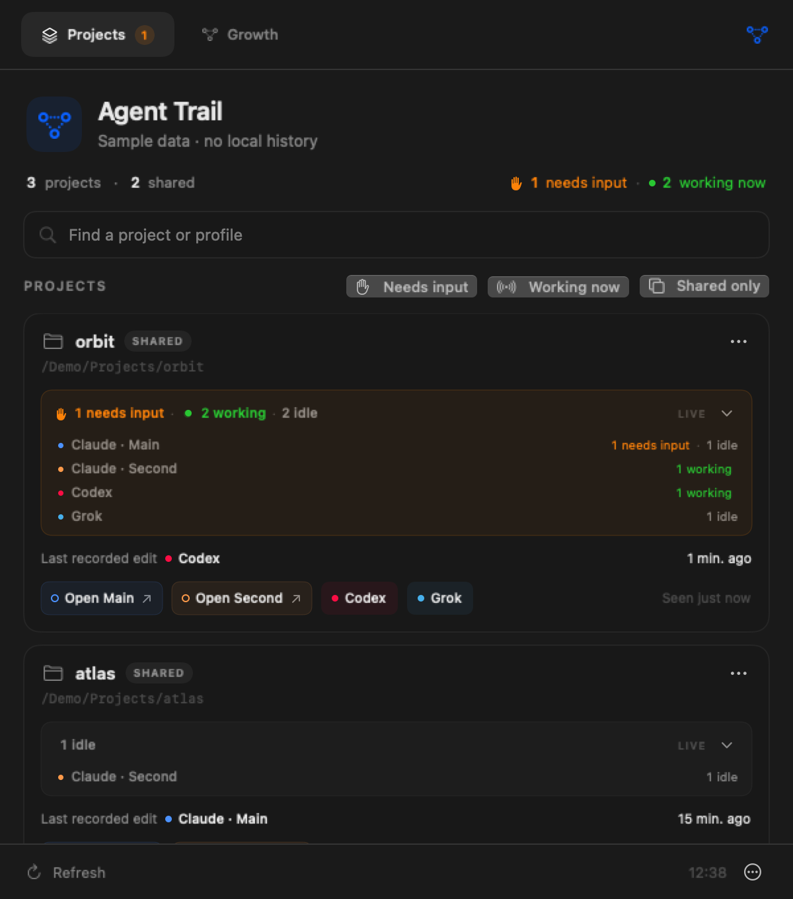
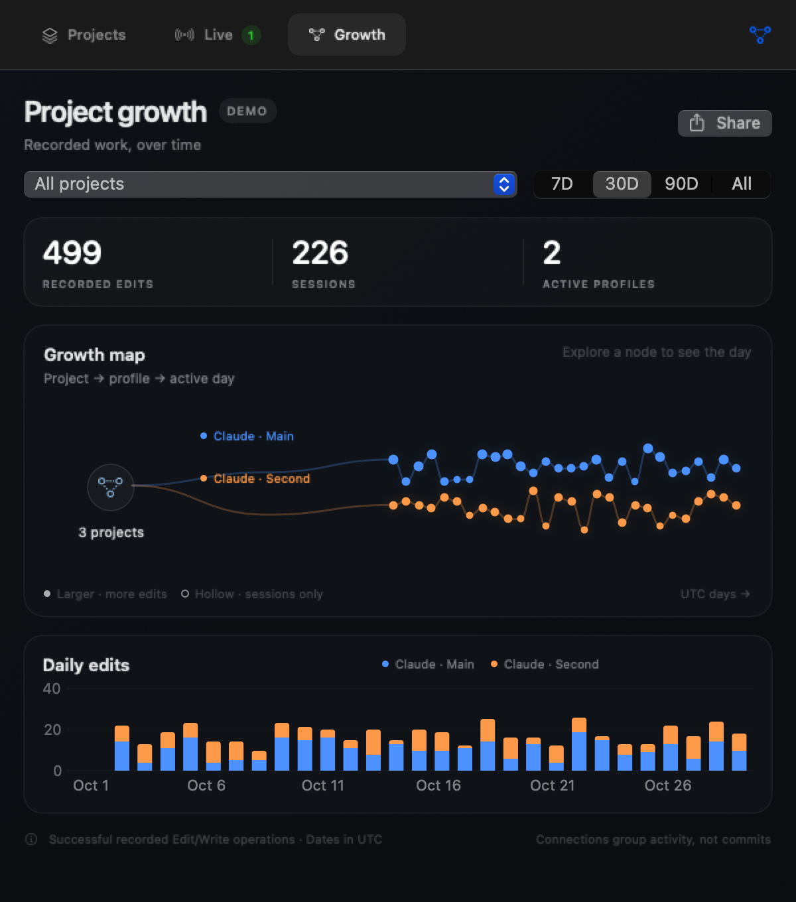
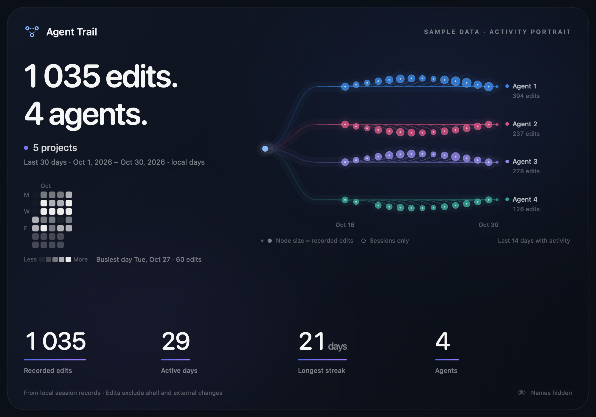
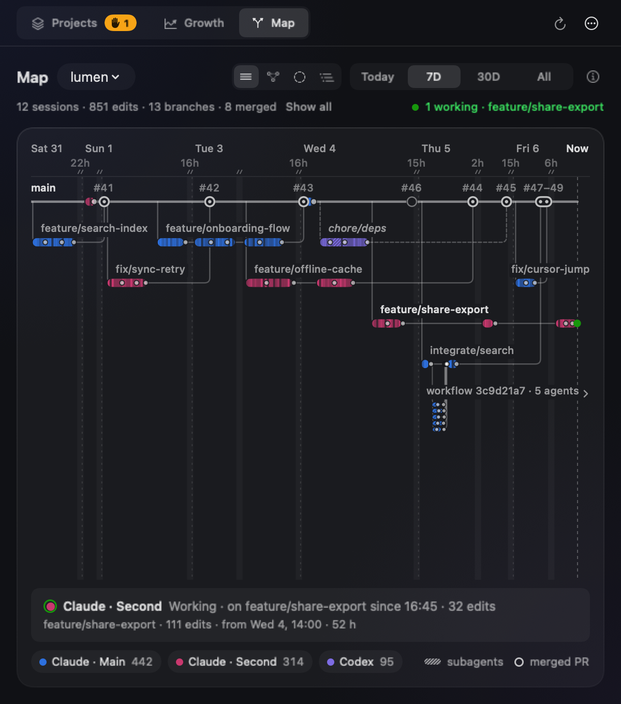

# Agent Trail

**Which agent touched this project last, and which one needs you now?**

A read-only macOS menu-bar app. Each Git repository gets one card across Claude, Codex, and Grok: which agent edited it last, history from the logs already on your Mac, and which live session needs you. When Claude says a session is idle but a command it started is still running, the card says **Working in background**.

**Works with** Claude Code in Claude Desktop's Code tab and `claude` in a terminal, Codex, and Grok. A Codex thread waiting for approval shows as Working. **Not supported:** Cursor, Gemini CLI, OpenCode. It can't answer prompts for you.

**Private by design:** no network, no account, no telemetry, no hooks. It never writes to your assistants' files.

**[0.1.0-alpha.13](https://github.com/NotYaz/agent-trail/releases/tag/v0.1.0-alpha.13) · Public alpha · macOS 14+ · [MIT license](LICENSE) · [Changelog](CHANGELOG.md) · [Website](https://agent-trail.app/)**

[](https://github.com/NotYaz/agent-trail/actions/workflows/ci.yml)

> **Long jobs stay visible.** When Claude starts a training run, a long build, or an evaluation sweep in the background and ends its turn, Claude reports the session as idle. Agent Trail sees that the session's own command is still running and shows it as **Working in background** until the job ends, so a quiet window never hides a run in progress. [How it works](#long-running-jobs-and-background-commands)



*Sample data. Project names, profiles, paths, and counts in these previews are synthetic.*

## Install

**Download** `Agent-Trail-macOS-universal2.zip` from the [0.1.0-alpha.13 release](https://github.com/NotYaz/agent-trail/releases/tag/v0.1.0-alpha.13), not the "Source code" archives: one app for Apple Silicon and Intel Macs on macOS 14 or later.

1. Unzip it and move **Agent Trail** to your Applications folder.
2. Open it. This alpha is ad-hoc signed and **not Apple-notarized**, so macOS stops the first launch. Close the warning without choosing **Move to Trash**. Within the next hour, open **System Settings › Privacy & Security**, click **Open Anyway** next to the Agent Trail message, then confirm with **Open Anyway** (**Open** on macOS 14) and your login password. You do this once per release. On macOS 14 you can instead Control-click the app, choose **Open**, and click **Open** again.

To skip the warning, run `xattr -dr com.apple.quarantine "/Applications/Agent Trail.app"` in Terminal before the first launch. To check the download before you open it, keep the ZIP and its `.sha256` file in one folder, go to that folder in Terminal (for example `cd ~/Downloads`), and run `shasum -a 256 -c Agent-Trail-macOS-universal2.zip.sha256`; it prints `Agent-Trail-macOS-universal2.zip: OK`. Safari may unzip the download and move the ZIP to the Trash; choose **Put Back** there to restore it for this check.

**Build from source** with **Swift 6+**, using Xcode or the Command Line Tools, from the repository folder:

```sh
./scripts/build-app.sh
open "dist/Agent Trail.app"
```

A local build opens without the warning. To keep it, copy `dist/Agent Trail.app` to your Applications folder. [Development](#development) covers tests and other build options.

## Why it exists

Two assistant instances. The same project open in both. Different worktrees, conversations, and changes. Returning to work should not begin with guessing which window has the latest context.

Agent Trail leaves each agent in its own app. It doesn't start, wrap, or drive any assistant, and it never touches your sign-ins. Claude keeps running in Claude Desktop or your terminal, Codex in Codex, and Grok in its terminal, each with its vendor's newest features. Agent Trail reads what they already record and takes you back to the right one. If Agent Trail stops working, your agents don't notice.

Agent Trail shows each project once, bringing its reported live sessions together with the **last recorded edit** and **latest saved activity** where history is available. A project is the Git checkout where an assistant's confirmed edits actually landed, so Claude, Codex, and Grok working in the same repository share one card even when they were started in different folders. A Claude worktree stays connected to that original folder, and a repository you move keeps its history.

- Search by project path or profile name.
- Filter to projects shared across profiles.
- See worktree context alongside recorded edits, and where a session was started when that was outside the project.
- Keep a project's history when you move its folder; earlier locations are remembered automatically.
- Jump straight to the work: each card's main button opens the most urgent live session (needs input, then working, then idle) in Claude, Codex, or the terminal running `claude` or Grok.
- Switch from the keyboard: ⌃⌥J opens a session switcher in any app, ⌃⌥⇧J jumps straight to the most urgent session, and `agenttrail://` links let Shortcuts, Raycast, or a Stream Deck do the same.
- See live Needs input, Working, Idle, and Unknown counts inside each project card.
- Keep long jobs in view: a Claude session whose background command is still running (a training run, a long build, a wait on another job) shows **Working in background**, not Idle.
- Read the Pulse strip at a glance: live sessions, edits in the last 7 days, active projects, and your day streak.
- Each card shows a 30-day sparkline, its recorded edits with the change from the previous 30 days, and which profiles did the work.
- Projects needing input sort first, followed by working projects; filter with **Needs input** or **Working**, or sort by edits, trend, or name.
- Explore Growth: recorded edits per day with a 7-day average, a 26-week Trail calendar, when your edits land by hour and weekday, the profile mix with delegated edits, and where edits landed.
- Map a project's branches: each session's runs of edits on the branch they landed in, with the commits and merges in your local Git history, as lanes, a tree, an orbit, or a log.
- Export a PNG activity portrait with project and profile names hidden by default.
- Keep everything local, with no account or telemetry.



## First run

The app opens its panel immediately and keeps a connected-dots icon in the menu bar, with no Dock icon. Switch between **Projects**, **Growth**, and **Map** inside the same 600 × 680 panel (⌘1, ⌘2, and ⌘3; ⌘F searches and ⌘R refreshes). Click away to hide it; click the icon to return. The first history scan runs in the background. Later history scans are incremental, every 15 seconds by default; live status checks run separately every 3 seconds.

Routine refreshes keep the last complete history visible while the next scan finishes. Tab changes and updates use gentle transitions that respect macOS Reduce Motion.

### Jump to the work

Each card's main button opens the session that most needs you: one waiting for input first (**Answer**), then a working one (**Open**), then an idle one (**Resume**). It shows the profile, the session title, and how long the session has been in that state when the assistant records it. The ⌄ menu next to it lists every live session, plus **Open in** your editor or terminal at that worktree, **Reveal in Finder**, **Copy path**, a recorded pull request, and **Bring {profile} forward**. Each session row in **Details** has its own ↗.

- **Claude Desktop:** opens that Code session with Claude's `claude://code/continue` link. This link is not publicly documented and may change. With several Claude instances (for example Main and Second), macOS hands every `claude://` link to the instance that was launched first, whichever one is in front (seen on macOS 15). Agent Trail sends the link only for that instance's sessions. For a session in another instance, it brings that instance forward and shows a short hint naming the session to pick, since the link would open the first instance's Code home instead.
- **Claude in a terminal:** brings forward the terminal app `claude` runs in, when the process environment identifies it, and names the folder of the tab to pick, since a terminal session has no title. In Claude Desktop's own terminal pane, that is the Claude instance holding the pane. It never sends a terminal session to a Claude Desktop Code session.
- **Codex:** opens the thread with `codex://threads/<id>` when the Codex desktop app owns it; otherwise it brings the owning app forward.
- **Grok:** brings forward the terminal app it runs in, when the process environment identifies it, including Claude Desktop's terminal pane.
- **Otherwise:** it brings the assistant's app forward, or shows the folder in your running editor or Finder.

Agent Trail opens a session or brings an app forward only after you click, press the switcher's shortcut, or open an `agenttrail://` link (see [Switch from the keyboard](#switch-from-the-keyboard)), and only when that app is already running. It never launches, quits, kills, or restarts an assistant, and it needs no Automation or Accessibility permission. **Open in** menu items can open your editor or terminal.

### Switch from the keyboard

Press **⌃⌥J** in any app to open the session switcher. It lists every live session in the right-click menu's order, needs input first, and numbers the first nine. While it is open, rows keep their place and number. Sessions that start meanwhile join at the end, and typing or reopening sorts the list again.

- Type to filter by project, title, branch, folder, or profile.
- ↑↓ or Tab select, and Return jumps. ⌘ and a digit picks that row. Before you type a filter, the digit alone does.
- Esc clears the filter, then closes the switcher and gives focus back to the app you were in.

**⌃⌥⇧J** skips the list and jumps straight to the most urgent session.

To change the shortcut, open the panel's ⋯ menu and choose **Session switcher**: ⌃⌥J, ⌃⌥A, ⌃⌥⌘J, or Off. The ⇧ chord follows your choice. The letter follows your keyboard layout: under Dvorak or AZERTY, ⌃⌥J is the key labeled J.

The shortcut goes through macOS's hot key service, so it needs no Accessibility or Input Monitoring permission, and it receives only its own two chords. While it is on, the app in front no longer gets those chords. If another app has already registered one of them with that service, the ⋯ menu says so. macOS does not report chords it uses itself, or chords that other apps watch for in other ways.

Launchers and scripts can open these links:

| Link | Opens |
|---|---|
| `agenttrail://jump` | The most urgent live session |
| `agenttrail://jump?project=my-app` | The most urgent live session in a project, by folder name (any case) or full path |
| `agenttrail://jump?session=ID` | One session, by the assistant's session or thread ID (`AgentTrailInspect --live` lists them) |
| `agenttrail://switcher` | The session switcher |

Some ways to open them:
- `open agenttrail://jump` in a shell.
- An **Open URLs** action in Shortcuts, which you can bind to a keyboard shortcut there.
- A Raycast quicklink.
- A Stream Deck button.

Percent-encode spaces in a project name or path. A link only picks among the live sessions Agent Trail already shows. It never names a file, an app, or a command, and Agent Trail ignores any other link with a short hint. A link starts Agent Trail if it isn't running, and the jump then waits for the first live check.

## Configure profiles

Open **Profiles…** from the panel's ⋯ menu to add or adjust profiles. When `profiles.json` is missing, the default configuration is:

| Profile | Assistant | Home | Desktop user data |
| --- | --- | --- | --- |
| Claude · Main | `claude` | `~/.claude` | Claude's default user-data location |
| Claude · Second | `claude` | `~/.claude-second` | `~/Library/Application Support/Claude-Second` |
| Codex | `codex` | `~/.codex` | none |
| Grok | `grok` | `~/.grok` | none |

Custom `CODEX_HOME` or `GROK_HOME` launch variables do not change history-scanning defaults; set each profile’s `configDirectory` to that custom home.

### Two Claude accounts

Many people keep a work and a personal Claude Desktop instance open side by side, each with its own user-data folder and Claude config folder. The default **Claude · Second** profile covers the common layout; add any other instance in **Profiles…**. Both accounts' Code sessions then appear on the same project cards. macOS hands `claude://` links only to the Claude instance launched first, so **Jump** opens that instance's sessions directly and brings any other instance forward with a hint naming the session (see [Jump to the work](#jump-to-the-work)). Links go to whichever instance has been running longest: to jump straight into the account you use most, open its instance first, and note that restarting an instance (for example for an update) changes which one that is.

A settings file that already exists is left as it is. Add Codex and Grok from **Profiles…**, or add the entries below and choose **Reload profiles**. Agent Trail does not merge new default profiles into a saved file.

Settings are stored at `~/Library/Application Support/AgentTrail/profiles.json`. This example shows the file structure:

```json
{
  "refreshInterval": 15,
  "sources": [
    {
      "id": "claude-primary",
      "name": "Claude · Main",
      "assistant": "claude",
      "configDirectory": "~/.claude",
      "bundleIdentifier": "com.anthropic.claudefordesktop"
    },
    {
      "id": "claude-second",
      "name": "Claude · Second",
      "assistant": "claude",
      "configDirectory": "~/.claude-second",
      "userDataDirectory": "~/Library/Application Support/Claude-Second",
      "bundleIdentifier": "com.anthropic.claudefordesktop"
    },
    {
      "id": "codex",
      "name": "Codex",
      "assistant": "codex",
      "configDirectory": "~/.codex",
      "bundleIdentifier": ""
    },
    {
      "id": "grok",
      "name": "Grok",
      "assistant": "grok",
      "configDirectory": "~/.grok",
      "bundleIdentifier": ""
    }
  ]
}
```

Use unique, stable `id` values. A profile saved before `assistant` existed still loads as Claude. Each Claude profile needs its config directory and the matching desktop user-data folder. Only the main `~/.claude` profile may omit the desktop folder to use Claude's default. Codex and Grok profiles must omit `userDataDirectory`. Leave `bundleIdentifier` empty unless that assistant has its own app, and do not reuse Claude's bundle identifier. Set `refreshInterval` between 5 and 300 seconds. A complete [example configuration](docs/profiles.example.json) is included. Choose **Reload profiles** after editing this file by hand. Invalid settings are reported instead of silently scanning another configuration.

Claude instance matching uses the bundle identity, process arguments, and `CLAUDE_CONFIG_DIR`. Codex and Grok homes match `CODEX_HOME` and `GROK_HOME` when those variables are set, and the default `~/.codex` or `~/.grok` when they are not. Matching a home does not focus a CLI process. An outlined profile dot means a unique running instance could not be identified. When identity is ambiguous or unavailable, Agent Trail reports the problem.

## What the timestamps mean

| Label | Evidence |
| --- | --- |
| **Last recorded edit** | The newest confirmed file edit. Claude counts a successful `Edit` or `Write`. Codex counts one completed `FileChange` item. Grok counts one completed `write` or `search_replace`. |
| **Latest activity** | The newest saved session activity, including work that may not change a file. |
| **Shared** | More than one configured profile worked in the same project, including across assistants. |

**This is a record of supported agent activity, not a complete audit of file changes.** Shell commands, external editors, unsupported assistants, and unrecorded changes are not attributed. Failed tools and user-modified results are excluded. A project with no recorded edits may still have changed. File modification times, directory names, and process lists do not establish which assistant made a change.

Codex history is read from rollout JSONL files under `~/.codex/sessions` and `archived_sessions` (or the custom home set in `configDirectory`). The session `cwd` is where it was started. A later turn counts only when its working folder stays inside that session's declared roots. One completed `FileChange` is one edit even when it lists several files, and it counts for the project its files landed in (see below). A helper thread with no repository edits of its own joins its parent thread's project when both were started in the same folder. Compressed `.jsonl.zst` archives are left unread. Older rollouts that record only `apply_patch`, without a completed `FileChange`, are not counted.

Grok history uses `summary.json` under `~/.grok/sessions` (or the custom home set in `configDirectory`). The session was started in `info.cwd`. The encoded session-directory name is not decoded into a path. Completed `write` and `search_replace` calls in the sibling `updates.jsonl` count as one edit each, and a positive `SearchReplace.EditsApplied` result must identify the files, which count for the project they landed in (see below). The edit time is the update timestamp: an ISO-8601 string, Unix seconds, or Unix milliseconds. A session with no `updates.jsonl` still appears, with a notice that its edit history is unavailable. The active-session registry alone does not establish a live state.

Claude history comes from the session logs under each profile's `projects` folder. A Claude Desktop session is matched to its log through Desktop's session index and counts for the checkout Desktop recorded. A log with no Desktop session counts as `claude` started in a terminal only when the first record that names its entrypoint and folder says `cli`; runs started by the SDK or `claude -p`, and logs Desktop no longer lists, are not counted. A terminal session starts in the folder (`cwd`) that record names, and its edits count for the project they landed in (see below), the same as Codex's. It belongs to the profile whose folder holds its log, so `claude` with the default `~/.claude` counts as Claude · Main, under the same avatar as that account's Desktop sessions. Edits recorded by a subagent count as delegated edits of the session that started it. Claude Code deletes terminal session logs after 30 days by default (`cleanupPeriodDays` in its settings), and their history leaves Agent Trail with them.

These on-disk formats are private implementation details and can change without notice. Missing or unreadable data appears as a profile notice. This alpha has not been tested against every assistant version or installation layout.

## When a project moves, or an assistant starts elsewhere

Assistants are often started in one folder and work in another. Codex may start in its own output folder and write into a repository below it. A folder may be moved after an assistant has already worked in it. Agent Trail keeps one card for the repository in both cases.

- **Edits count where they landed.** Each confirmed edit counts for the Git checkout that contains its files, after following symbolic links. A session started in a parent folder belongs to that checkout when its edits landed in exactly one. Its card then shows **Launched from · <folder>**.
- **Files outside any checkout stay where they were written.** Notes or drafts an assistant saved next to a repository count on the folder it was started in, not on the repository.
- **Edits spanning several checkouts are not merged.** Each edit still counts for its own checkout, and the session stays with the folder it was started in. Repositories are never matched by name or remote.
- **A link left behind is remembered.** After `mv old new && ln -s new old`, edits recorded under `old` count for `new` right away. Agent Trail remembers the earlier path, so deleting the link later changes nothing. The card shows **Previously at · <old path>**.
- **A plain move is followed.** Agent Trail keeps a bookmark and folder identity for every repository it has attributed work to. If one is moved on the same disk, its history follows it on the next scan.
- **Otherwise, locate it once.** A repository moved to another disk shows **Folder not found**. A repository moved before Agent Trail ever saw it shows *N edits in a folder that no longer exists*. Choose **Locate…** and pick the folder where it lives now. The folder must contain the project's `.git` folder; for missing edits it must also contain the recorded subfolders. An existing folder is never claimed as another folder's earlier location.
- **A new folder at an old path is its own project.** If something else appears at an earlier location, only records made before it appeared still count for the moved project.

Search also matches earlier locations and launch folders. **Forget earlier locations…** in the project menu removes them. Only Git metadata (`HEAD`, `commondir`, `gitdir`) is read to recognize a repository, and a repository at your home folder or above it is never treated as a project.

## Check live status on a project

Live status is available for Claude Desktop, `claude` in a terminal, loaded Codex threads, and registered Grok sessions. Each adapter requires runtime presence and explicit status or turn events; recent edits and file timestamps do not establish a live state.

The **Projects** tab shows live session counts directly inside each project card, both in total and by profile. Projects with a reported input request sort first, followed by projects with working sessions, under every sort. The Pulse strip shows needs-input and working counts. Use **Needs input** or **Working** to filter those projects. Selecting both includes projects with either state; search and **Shared** still apply.

The menu-bar icon shows the same at a glance:

| Icon | Meaning |
| --- | --- |
| Plain trail | Nothing is working or waiting. |
| A dot travelling along the trail, with a number inside | At least one session is working. The number in the triangle says how many, including sessions working in background, and + means ten or more. With Reduce Motion or Low Power Mode, a still dot instead. |
| Amber and filled, with a count | A session needs input. It bounces once when a new request arrives. |
| Checkmark, for a few seconds | Work just finished and nothing else is running. |

Right-click the icon for a list of live sessions grouped by state; choose one to jump to it, or choose **Session Switcher…** to open the switcher. The panel's ⋯ menu has **Session switcher** for the [keyboard shortcut](#switch-from-the-keyboard), **Menu bar** settings (animation, the working and needs-input counts), **Show session titles**, and **Theme**: Classic, Gentle (brighter surfaces, indigo sparklines and calendar), Vivid (Gentle plus brighter profile colors that stay apart for color-blind readers), or Aurora (Vivid plus an indigo Trail calendar and a stronger wash). Session titles and Claude's "needs you to…" sentence come from your conversations: they are read live, kept in memory only, and never cached, exported, or included in renders.

Expand a card's live details with **Details** to see each session's recorded workspace, worktree context, and last-report age. Sessions are matched to your configured assistant homes. A Claude Desktop session requires a matching desktop session record, and `claude` in a terminal reports its own folder; Codex requires a thread-writer handle held open by a verified app-server; Grok requires a registered session with a matching process start. Unmatched sessions are omitted.

A session started outside a project joins the project its recorded edits landed in, so a Codex thread started in a parent folder appears on the repository's card. A Claude window still reporting a folder that has moved appears at the folder's current location.

A project can have a session needing input while another is working or idle, so the card keeps separate counts instead of hiding them behind one state. **No live sessions reported** does not mean idle. Projects found only through live reports still appear, without inventing saved sessions or edit history for them.

| Status | Meaning |
| --- | --- |
| **Needs input** | Claude reported `waiting`, or Grok reported an unresolved permission request. Codex input dialogs are not distinguished by the currently available state. |
| **Working** | Claude reported `busy`, Codex has an `inProgress` turn on a loaded thread, or Grok has an active turn/working phase. Claude also counts while it reports `idle` but a command its last turn started is still running, or reports `shell` for that state itself, shown as **Working in background** (see [Long-running jobs](#long-running-jobs-and-background-commands)). |
| **Idle** | Claude reported `idle`, or a loaded Codex/Grok session explicitly ended its turn. It does not establish that you need to reply. |
| **Unknown** | The status is unrecognized or cannot be verified under the applicable freshness checks. |

Claude writes these registry reports when status changes, rather than sending a regular heartbeat. A waiting, busy, or idle report can remain valid while the same verified process is alive, even when the report is old. Agent Trail shows that report's age. If the process start cannot be verified, the fallback accepts only reports from the last 90 seconds; older reports become Unknown. Unrecognized or implausibly future-dated reports are also Unknown. Dead processes and reused process IDs are omitted.

**Needs input requires an explicit request.** Claude uses its waiting signal for input requests, approvals, and other dialogs needing attention; Grok records permission requests. Inactivity and old activity dates do not turn Idle into Needs input. Request text is not retained. Check the corresponding assistant to respond.

Codex live status combines open thread-writer handles under `thread-writer-locks/` with the newest turn status in `thread_history_1.sqlite`, opened read-only. A leftover lock file or an old `inProgress` row without a verified app-server holding its writer handle is insufficient. Codex does not persist a distinct approval/input state in the inspected schema, so an in-progress turn can include time spent waiting for you. Its workspace is the recorded thread workspace; individual tool working directories are not separately tracked.

Grok live status joins `active_sessions.json` to the matching session summary, verifies the registered PID and microsecond process-start time, and reads explicit lifecycle events from `events.jsonl`. A registered session without a recognized event is Unknown. Completed and cancelled turns become Idle; permission requests become Needs input until resolved.

**Working describes a reported active turn, or a command that turn left running.** It does not claim that a file is being written or that work has succeeded. Recent edits, file modification times, and CPU usage do not determine live status; the only process fact used is whether a Claude session's own command is still running. Missing live reports do not establish that every assistant has stopped.

## Long-running jobs and background commands

Agents now hand off work that runs for hours: training or fine-tuning a model, a full test or benchmark suite, a data migration, a large build. Claude usually starts such a job as a background command and ends its turn, so its own status report says **idle**, even though the session still owns a job in flight and will pick it up again when the command finishes. With several sessions open, the one watching a six-hour run looks exactly like the ones you finished with this morning.

Agent Trail tells them apart. While a command that a Claude session started during its last turn is still running, the session shows **Working in background** instead of Idle:

- It counts as Working on its project card, in the Pulse strip, and under the **Working** filter.
- The menu-bar dot keeps travelling along the trail.
- The Jump menu and session tooltips say "Working in background", and the session's tooltip under **Details** says when the command started.
- When the command exits, the session returns to the state Claude reports. Claude usually picks up the result and works again, and the menu-bar checkmark appears once nothing is running.

### How it works

Each Claude Code session, in Claude Desktop or a terminal, runs as one `claude` process. Every Bash command it starts, in the foreground or the background, is a child of that process and leads its own process group. MCP servers are children too, but they stay in Claude's process group.

```text
Claude Desktop
└─ claude              one Code session; its registry record says "idle"
   ├─ node mcp-server  MCP server: in Claude's process group, ignored
   └─ zsh -c …         Bash command: leads its own group → Working in background
      └─ python train.py
```

On every live check (every 3 seconds), for each Claude session reported idle, Agent Trail lists that process's children and keeps the ones that:

1. lead their own process group,
2. started **before** the idle report, so they belong to the turn that just ended (a hook that runs after the turn does not count), and
3. are still running rather than exited and waiting to be reaped.

If any remain, the session is Working in background, and the oldest one's start time is shown. Busy, waiting, and Unknown sessions are unchanged, and the same process checks as for every Claude status apply.

Claude can also report this state itself, as `shell`: its turn has ended and a command it started keeps running. Agent Trail shows that as Working in background too and runs the same check. When the command is still one of the session's children, its start time is shown; otherwise the turn's end is, since the command began no later than that.

Only each child's parent process ID, process group, start time, and run state are read, through macOS `libproc` (`proc_listchildpids` and `proc_pidinfo`). Agent Trail does not read command lines, arguments, environment variables, or output, starts no helper process for this check, and sends no signals.

### Make your long jobs visible

Agent Trail can see a job only while it is attached to the session. Two patterns work well:

- **Let Claude run the job as a background command**, for example by asking it to start `python train.py` in the background and check the result when it finishes. The command stays a child of the session for as long as it runs.
- **For a job that is already detached**, started with `nohup … &`, `setsid`, `tmux`, `screen`, or a job scheduler, ask Claude to wait on it in the background, for example with `while kill -0 <pid>; do sleep 300; done`. The wait loop is a child of the session, so the session stays Working in background until the job exits, and Claude is told when the wait ends.

`AgentTrailInspect --live` prints `backgroundSince` for each session working in the background, which shows exactly what Agent Trail sees.

### Limits

- A background command that never exits on its own, such as `tail -f` or a development server started as a background command, keeps its session Working in background until it stops or the session closes.
- A job fully detached from the session, with no command waiting on it, is adopted by `launchd` and cannot be tied to any session, unless Claude itself still reports the session as `shell`.
- This applies to Claude sessions, in Claude Desktop and in a terminal. Codex and Grok live status are unchanged.

## Explore project activity

Choose the **Growth** tab in the floating panel, or click a Pulse tile or **Show in Growth** on a card. Select a project or **All projects**, then filter to **7D**, **30D**, **90D**, or **All**.

- **Recorded edits, Active days, Saved sessions, Busiest day.** Totals for the period, with the change from the previous period of the same length. Active days count days with at least one edit, with your current and best streak.
- **Recorded edits chart.** Bars per day, week, or month by profile, with a dashed 7-day average and the peak marked. Switch to **Sessions**, or to a running total. Select a bar for the per-profile breakdown, and click a legend chip to focus one profile everywhere.
- **Trail calendar.** The last 26 weeks, one cell per day, shaded by recorded edits, with totals per weekday.
- **When edits land.** A punch card of edits by weekday and local hour, the peak hour, the share of late-night work, and a label such as *Night owl* or *Daytime*. It needs at least 50 edits in the period and is never included in exported images.
- **Profile mix.** Each profile's share of recorded edits, the change in share, when it first appears in saved history, and how many of its edits were **delegated**: first recorded in a Claude subagent or a spawned Codex thread. Grok does not report delegation. A footer counts days when two or more profiles edited the same project.
- **Where edits landed.** For all projects, the projects ranked by recorded edits, split by profile.

How the numbers are counted:

- **Local activity days.** Days follow your Mac's time zone and start at 05:00, so work after midnight counts toward the evening it began. Hours in **When edits land** are local wall-clock hours.
- **Recorded edits** count confirmed file edits. Claude counts a successful `Edit` or `Write`. Codex counts one completed `FileChange`. Grok counts one completed `write` or `search_replace`. One tool operation counts as one edit, regardless of its size. Shell commands do not count.
- **Saved sessions** count on the day they started. A session means different things per assistant, so do not compare them across assistants.
- **Changes are shown only when saved history covers the previous period.** Assistants delete old sessions, so an empty earlier period often means "not recorded". Streaks and totals cover only the history still on disk and can shrink.
- Replayed tool results and repeated records across transcript files are deduplicated within each project's profile history.

Counts do not measure code quality, project size, lines of code, or productivity, and they do not show Git ancestry or dependencies between agents. Shell and external changes remain outside these statistics. Changing the period or project animates the charts from zero against the new scale; Reduce Motion shows the result directly. The activity tree now appears only on the exported portrait. `AgentTrailInspect` reports both `dailyHistoryUTC` and `localDays`.

## Export an activity portrait

From Growth, choose **Share** to preview the card, then **Export PNG…** to save it to a location you choose on your Mac. The card uses the selected project and period. Its headline, totals, longest streak, and a mini calendar (or a 7-day strip) cover only that period. Project and profile names are hidden by default, using labels such as “My project” and “Agent 1”; turn on **Show project and profile names** to include them. Folder paths are never included, and the hour-of-day rhythm is never exported. Activity totals, dates, and day patterns remain visible.



*Sample portrait. Export saves a local PNG; it does not post or upload anything.*

Review a card before sharing it. Hiding names does not hide dates, counts, or patterns of activity.

## Map a project's branches

Choose the **Map** tab (⌘3), then a project from the menu beside the title and a range: **Today**, **7D**, **30D**, or **All**. The Map draws that project's Git branches over time, each session's edits on the branch they landed in, and the commits and merges Git recorded. Edits come from the same saved history as the project cards, and only edits inside the project are drawn. Days start at 05:00, as in Growth.



The icons beside the range pick one of four views:

- **Lanes.** The trunk along the top and a lane for each branch below it, with time running left to right. See [Read the lanes](#read-the-lanes).
- **Tree.** The branches as a tree off the trunk, with branches merged into an integration branch one step further right. Each node is a ring split by profile, each link is as wide as the edits that flowed back through it, related branches stack into one node until you click it, and a strip of days on the right keeps the dates.
- **Orbit.** The range as a ring clock that runs clockwise to now at the top, with idle hours folded. Branches leave the ring as petals at their fork and come back at their merge, and sessions run as tracks inside the ring, around a dial with the totals or the item under the pointer.
- **Log.** A vertical Git log, newest on top. Each branch is a column from its fork to its merge, sessions are thick segments on their branch's column, and a list names each branch at its tip, indented under the branch it merged into.

Hover over a session, branch, commit, or idle stretch for its details in the strip under the map, and click to pin it. The strip offers **Jump** for a live session, **Open** for a cloud session, and **Copy** for a commit's SHA. Click a profile in the legend to dim the others.

### Read the lanes

- **Bars are runs of edits.** Each bar is one session's run of edits on one branch, brighter where edits were denser and hatched where subagents made them. A run ends when the session pauses for more than 20 minutes (Today), 30 minutes (7D), or an hour (30D and All). Runs that overlap on one lane stack, up to three deep. Spawned Codex threads join the session that started them.
- **Which branch an edit counts for.** Uncommitted changes travel with the next commit, so an edit counts for the branch of the next commit in its working tree, when that commit follows within 12 hours. The carry passes through pulls, fast-forwards, and `checkout -b` to a new branch. Checking out an existing branch, a reset, or any other move before that commit leaves the edit on the branch that was checked out when it was made. In a linked worktree inside the project, such as Claude's `.claude/worktrees/<name>`, an edit counts for the branch its own Claude Desktop session recorded for that folder, so a worktree removed since keeps its branch. Otherwise the worktree's own reflog decides, then a branch another session recorded for the folder, then a branch named after the folder. A worktree whose branch cannot be found gets a lane named after its folder.
- **Commits and merges.** Commits sit on the lane of the branch they were made on: from the reflog where they were made locally, otherwise from each branch's chain of first parents. A branch has merged at a merge commit that brings in one of its commits, at a trunk commit that records its head's tree (a squash merge), or at a trunk commit GitHub made whose subject is one of its commit subjects plus ` (#N)`. A landing on the trunk is a bead: a bold ring with a dot when it is matched to a branch's lane, and a hollow ring otherwise, as for a branch no session edited. A branch that others merged into keeps its own lane, with those branches below it.
- **Idle time folds.** Pauses of more than about 40 minutes (Today), 75 minutes (7D), or 3.5 hours (30D and All) fold into narrow `//` seams, so bursts of work get the room; each run and commit keeps a few minutes of room on either side. The longest seams are labelled with their length, such as `4.5h` or `3d`, and hovering a seam shows its length. When work came before the repository's first commit, the trunk says **before Git** where there is room.
- **Work side by side shares a row.** Branches a session worked on at the same time, such as a workflow's agents in their own worktrees, are drawn as thin strands of one row, a bundle: three or more branches, or two agents of one workflow run. The trunk and branches that others merged into keep rows of their own. Click a bundle's title to open it into a lane per strand, and click it again to fold it.
- **Many branches fold into streams.** Past 14 branches, counting a bundle as one, related branches share one row: branches merged into the same integration branch, branches with the same prefix, such as `fix/`, or the agents of one workflow run. **Show all** draws every branch on its own lane, with no bundles or streams, and **Group** brings them back.
- **Cloud sessions.** Claude Code sessions on claude.ai keep no history on your Mac. Their commits carry a `Claude-Session: https://claude.ai/code/session_…` trailer, so each one shows as pale bars across its commits on each branch, under **Cloud** in the legend. They count no edits, and commits GitHub made, such as a pull request's merge, do not count as their work. A project with only cloud work does not appear, since projects come from sessions and edits recorded on your Mac.
- **Live sessions.** A session that is working or needs input draws a thread from its last edit to now, ending in its status glyph, and the line above the map shows it. A session started in the project with no edits in the range shows on its branch while it works or needs input. Hovering a session draws dotted threads where it moved from one branch to another.

### The Map window

On the Map tab, the expand icon next to Refresh opens the Map in its own window. It shares the panel's project, range, and view, and keeps its own hover and pin. Resize it freely, down to 640 × 640 points below the title bar; it remembers its size and position. There, Lanes takes the width its branches, commits, and labels need, up to 8,000 points, and scrolls sideways, opening at now.

At 980 points wide or more, a details panel sits beside the map; the sidebar button beside the range shows or hides it. Its top part describes the project, the item under the pointer, or the item you pinned. A click pins an item and opens a fuller view with rows you can click; **Back** (⌘[) returns to the previous pin, and Esc unpins. A narrower window shows the strip under the map, as the panel does. ⌘R refreshes, and ⌘W closes the window.

### What the Map reads

The Map reads Git only while it is on screen, in the panel or its window, and never changes the repository. It reads Git again when you open it, change its project or range, or press Refresh, and when that project's sessions or live status change; otherwise it reads at most once a minute. Merges made on GitHub appear once you fetch them. Commits and merges need a real `git` from Xcode, the Command Line Tools, or Homebrew; without one, the Map still shows branches from the reflogs, with no commits. [Privacy](#privacy) lists what it reads and runs.

## Privacy

Indexing happens on your Mac. Agent Trail reads Claude desktop session indexes and JSONL logs (a log Desktop does not list is opened to read the entrypoint and folder of its opening records, which stay in memory), Codex rollout JSONL files, and Grok `summary.json` plus `updates.jsonl`. It does not decompress Codex archives or read assistant databases for edits. Live status reads Claude process-registry records and, for each Claude session process, its children's parent, process group, start time, and run state (never their arguments); for `claude` in a terminal, once its process start is verified, its `TERM_PROGRAM` and `__CFBundleIdentifier` values to name the terminal, as for Grok; Codex app-server writer-handle presence and read-only turn metadata, and Grok process-registry/lifecycle events. These checks do not write assistant data or infer status from recent edits. After you click Jump with several instances of the host app running, it reads the parent process IDs of the session's ancestors to find the instance it runs under. The app does not send those records anywhere, inject code, install hooks, or edit assistant data. There are no telemetry, cloud accounts, or automatic update checks.

Incremental caches live under `~/Library/Application Support/AgentTrail/`: `activity-cache.json` (Claude, version 2), `activity-cache-codex.json` (version 4), and `activity-cache-grok.json` (version 4). They store file positions, tool IDs, confirmed-edit dates, project/workspace paths, and related indexing metadata. The Codex and Grok caches, and the Claude cache for terminal sessions, also keep the parent folders of edited files. The Claude cache can briefly keep the full target path of an `Edit` or `Write` whose result has not been recorded yet, for example while a permission prompt is open or after an interrupted session. Confirmed tool IDs retain their date and workspace so daily totals survive incremental scans and replayed results can be deduplicated. The caches do not store prompts, commands, patches, diffs, or conversation text. Paths and timestamps can still be sensitive; keep caches and diagnostic output private. Growth statistics are computed in memory from these records; nothing new is cached. A cache is written only after a scan changed it, at most every 5 minutes, and once more when Agent Trail quits. An unreadable or unknown cache version is rebuilt. With Agent Trail closed, deleting a cache causes a fresh index of that assistant on the next launch.

`project-locations.json` (mode 0600) in the same folder remembers repositories Agent Trail attributed work to. It holds their current and earlier folder paths, which are learned from session evidence, plus a macOS bookmark and folder identity: device, inode, and creation date. It holds no prompts, commands, diffs, or conversation text, but the paths can still be sensitive; keep it private like the caches. An unreadable file is reported and never overwritten. With Agent Trail closed, deleting it forgets learned earlier locations; links still present are learned again.

The Map reads Git only while it is on screen, and only for the project it shows. It reads that checkout's reflogs as files (`logs/HEAD` for the main working tree and for each linked worktree that still exists, plus each worktree's `HEAD`), skipping the name and e-mail address on each line; without a real Git, it also reads branch names and heads from the files under `refs/heads` and `refs/remotes` and from `packed-refs`. It then runs Git three times per build, all read-only: `for-each-ref` for branch, remote-tracking branch, and tag names; `log --all --reflog` for up to 4,000 commits, starting a day before the range or the project's first session or cloud commit, whichever is later; and a `log --grep` for the oldest commit with a `Claude-Session` trailer. It uses a real Git from the developer directory `xcode-select` points to, the Command Line Tools, Xcode, or Homebrew, never `/usr/bin/git`, which on a Mac without the developer tools asks to install them. Git runs with no terminal or prompts, with optional locks, the file-system monitor, signature display, hooks, replace objects, lazy fetches of missing objects, and every transport protocol turned off. Its environment holds only `HOME`, `PATH=/usr/bin:/bin`, `LC_ALL=C`, and the `GIT_*` variables for those switches, and it is stopped after 10 seconds (3 for the trailer search). From each commit the Map keeps its hash, parents, tree, committer date, subject, `Co-Authored-By` names without addresses, and the session ID of a `Claude-Session` link to claude.ai. The committer name is checked only to tell whether GitHub made the commit, and is not kept; author names and the author's and committer's e-mail addresses are not requested from Git, and the address in each `Co-Authored-By` trailer is dropped as the commit is read. From the Claude Desktop session records it already reads, the Map also uses the branch each session recorded for each folder it worked in (`writtenBranches`). The Map is built in memory, and nothing of it is cached or written to disk; only the Map window's size and position and whether its details panel shows are saved as preferences. A cloud session's claude.ai page opens in your browser only when you click **Open**.

External links in the app open in your browser only when selected. See [security and reporting](SECURITY.md) before sharing an issue or diagnostic output.

## Preview with sample projects

```sh
swift run AgentTrail --demo
```

Demo mode uses synthetic projects and live states. It does not read Claude histories, process-registry records, your profile configuration, or the activity cache. It is suitable for screenshots and walkthroughs. Quit the demo from its menu when finished.

Render sample images directly to files without reading your assistant history:

```sh
swift run AgentTrail --render-demo /tmp/agent-trail-projects.png
swift run AgentTrail --render-growth-demo /tmp/agent-trail-growth.png
swift run AgentTrail --render-share-demo /tmp/agent-trail-share.png
```

`--render-status-demo OUTPUT.png` draws the menu-bar icon states large and at real size (2x and 1x), with the nodes the working animation follows marked in order. `--render-switcher-demo OUTPUT.png` draws the session switcher with sample sessions. Add `--light` for the light appearance, `--height N` to render a taller panel for review, or `--theme classic|gentle|vivid|aurora` to render a color theme without changing your saved choice. Renders pin the clock to 30 October 2026, 18:40, so they are repeatable. The older `--render-live-demo` flag remains an alias for the combined Projects preview.

Demo mode has no Map data, and its Map tab says so. `--render-map SNAPSHOT.json OUTPUT.png` draws the Map from a snapshot saved with `AgentTrailInspect --map` (see [Development](#development)). Add `--mode lanes|tree|orbit|log`, `--range today|7d|30d|all` (7d by default), `--all-branches` to turn off bundles and streams, `--open-bundles` to draw every bundle open, `--window WxH` to render the Map window's content instead of the panel, or `--pin KIND` to pin an item as a click would. Unlike the sample renders, a snapshot holds a real project's paths, branch names, and commit subjects, so keep snapshots and their images private.

## Development

There are no third-party package dependencies. The Swift package includes the native app, a reusable core, tests, and a diagnostic CLI.

```sh
# Run the test suite.
swift test

# Build for a specific CPU, or create a universal binary.
./scripts/build-app.sh --arch arm64
./scripts/build-app.sh --arch x86_64 --output-dir dist/intel
./scripts/build-app.sh --arch universal2 --output-dir dist/universal

# Preview local metadata without storing a scan cache.
swift run AgentTrailInspect --metadata-only

# Read current runtime status without scanning edit history.
swift run AgentTrailInspect --live

# Show learned project locations and which sessions joined another project.
# Reads project-locations.json (or the --locations file) and never writes it.
swift run AgentTrailInspect --locations ~/Library/Application\ Support/AgentTrail/project-locations.json

# Save what the Map draws for one project (session trails, Git history, live sessions) as JSON.
swift run AgentTrailInspect --map ~/Developer/my-app > /tmp/my-app-map.json

# Print the Map built from a snapshot: lanes, runs, commits, and merges.
swift run AgentTrailInspect --map-summary /tmp/my-app-map.json --range 30d
```

Each build creates `Agent Trail.app`, `Agent-Trail-macOS-<architecture>.zip`, and a matching `.sha256` file in the selected output folder. Architecture-specific ZIPs run on that architecture; `universal2` contains both arm64 and x86_64. Cross-architecture compilation does not validate execution on the other architecture.

`ARCH` can set the build architecture and `AGENTTRAIL_BUILD_DIR` can select a separate Swift build cache. The build script does not install or launch apps. Inspection reads your real local data and can print project paths; review its output before sharing. The CLI uses saved profiles (or defaults if settings are absent). Pass `--profiles /path/to/profiles.json` to inspect a separate configuration.

CI runs tests and packages the app on Apple Silicon and Intel macOS runners. The manually triggered **Release artifacts** workflow produces ZIPs and checksums for review; it does not publish a release or upload code to another repository. Runner labels follow GitHub's [hosted runner documentation](https://docs.github.com/en/actions/how-tos/write-workflows/choose-where-workflows-run/choose-the-runner-for-a-job).

Read [CONTRIBUTING.md](CONTRIBUTING.md) for development guidance. New adapters should translate supported records into `ProjectActivity` through `ActivityProvider`, keeping recorded edits separate from general activity.

## Alternatives, and when to use them

- **Answering prompts from the menu bar:** [Muster](https://github.com/josefchen/muster). Agent Trail only takes you to the session.
- **Claude Code's own list of its background sessions:** Claude's [agent view](https://code.claude.com/docs/en/agent-view) (`claude agents`).
- **Usage limits and cost:** [CodexBar](https://github.com/steipete/CodexBar) or [ccusage](https://github.com/ryoppippi/ccusage). Both work fine next to Agent Trail.
- **Starting and orchestrating agents:** [Conductor](https://www.conductor.build/), [Vibe Kanban](https://github.com/BloopAI/vibe-kanban), or [cmux](https://github.com/manaflow-ai/cmux).

Agent Trail is for people who want one card per repository across Claude (Desktop and terminal), Codex, and Grok, both Claude accounts in one place, and long jobs that stay visible after Claude goes idle.

## What's next

- Claude Code runs started by the SDK or with `claude -p`.
- Codex input/approval state when a reliable local signal becomes available.
- Gemini CLI, OpenCode, and Cursor, once their local tool results can be confirmed. They are unsupported in this release.
- More coverage of changes made through agent shell commands.
- Optional launch at login, so the switcher's shortcut works from the moment you sign in.
- Signed, notarized downloads and a simpler installation path.

## Support the project

[Bug reports](https://github.com/NotYaz/agent-trail/issues), compatibility reports, and thoughtful contributions help the alpha mature.

## Donations

Agent Trail is free. A donation is optional, and every feature stays available either way.

- **GitHub Sponsors:** [NotYaz](https://github.com/sponsors/NotYaz)
- **Buy Me a Coffee:** [buymeacoffee.com/lltod](https://buymeacoffee.com/lltod)
- **Crypto:** Bitcoin; ETH, USDC, and USDT on Ethereum, Base, or Arbitrum One (one shared address); and USDT on TRON (TRC-20). The addresses and QR codes are in [Support](docs/SUPPORT.md#crypto).

The same links are listed in [Support](docs/SUPPORT.md). Agent Trail does not take payment inside the app.

Agent Trail is an independent project, not affiliated with Anthropic, OpenAI, xAI, or other assistant vendors. Licensed under [MIT](LICENSE).
