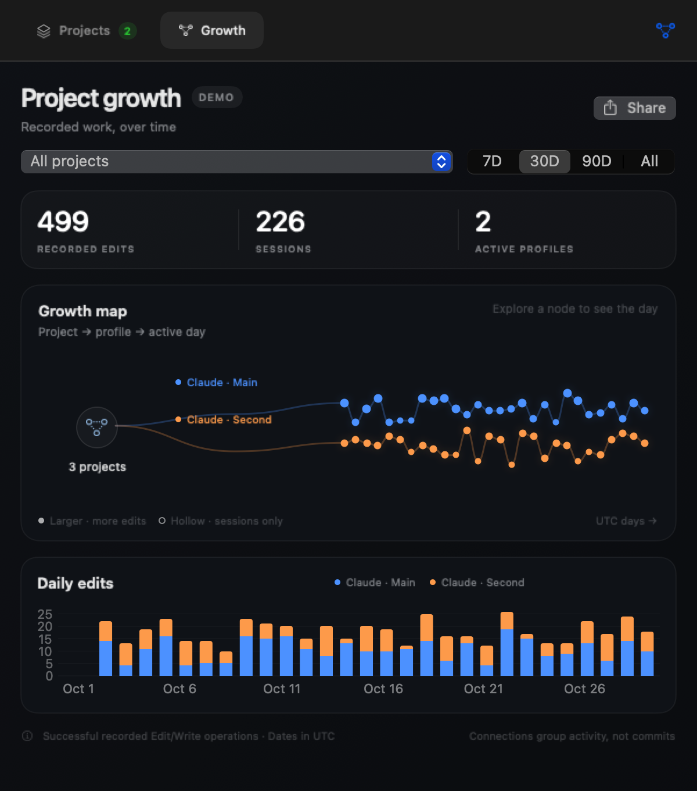
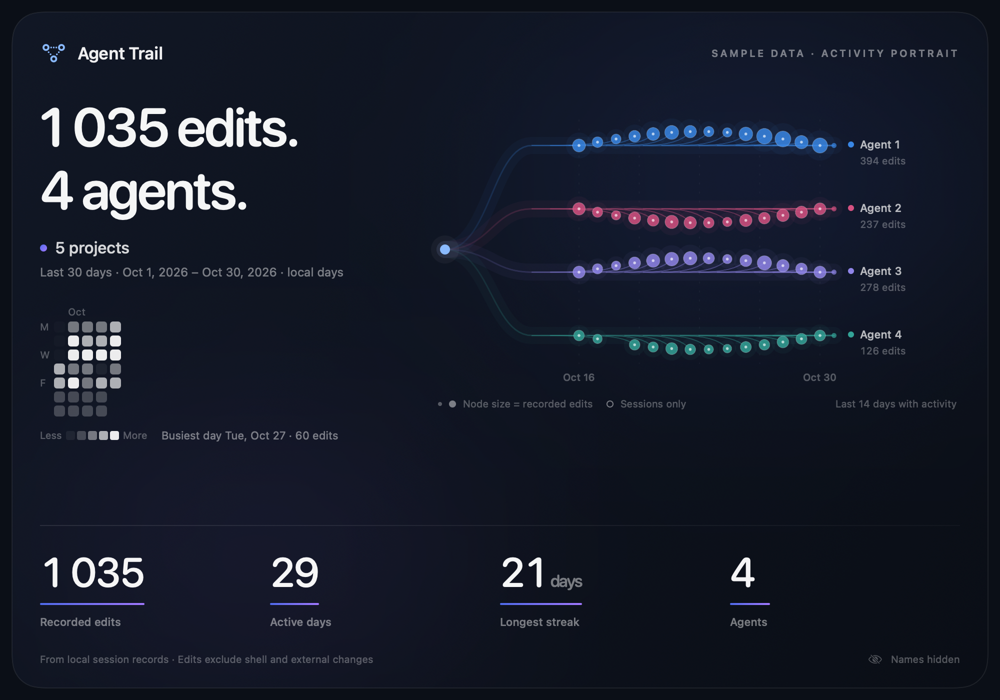

# Agent Trail

**Which agent touched this project last?**

A small native macOS menu-bar app that brings your coding projects into one place. See recorded edits and reported live status together on each project, then jump back to the right running app. Projects and Growth share one compact floating panel.

**0.1.0-alpha.3 · Public alpha · macOS 14+ · Claude Desktop profiles · MIT license**

Agent Trail currently supports multiple Claude Desktop profiles. Codex and Grok adapters are not implemented; other assistants remain on the roadmap.


*Sample data. Project names, profiles, paths, and counts in these previews are synthetic.*

## Why it exists

Two assistant instances. The same project open in both. Different worktrees, conversations, and changes. Returning to work should not begin with guessing which window has the latest context.

Agent Trail shows each project once, bringing its reported live sessions together with the **last recorded edit** and **latest saved activity** where history is available. A shared project stays connected to its original folder even when work happens in a separate Claude worktree.

- Search by project path or profile name.
- Filter to projects shared across profiles.
- See worktree context alongside recorded edits.
- Focus an identified running Claude instance with one click.
- See live Working, Idle, and Unknown session counts inside each project card.
- Working projects sort first; **Working now** filters to those projects.
- Explore an activity tree and daily edit/session counts by project and agent profile.
- Export a PNG activity portrait with project and profile names hidden by default.
- Keep everything local, with no account or telemetry.



## Try it

Build from source with **Swift 6+**, using Xcode or the Command Line Tools, on macOS 14 or later:

```sh
swift test
./scripts/build-app.sh
open "dist/Agent Trail.app"
```

Run these commands from the repository folder. The app opens its panel immediately and keeps a connected-dots icon in the menu bar, with no Dock icon. Switch between **Projects** and **Growth** inside the same 600 × 680 panel. Click away to hide it; click the icon to return. The first history scan runs in the background. Later history scans are incremental, every 15 seconds by default; live status checks run separately every 3 seconds.

Routine refreshes keep the last complete history visible while the next scan finishes. Tab changes and updates use gentle transitions that respect macOS Reduce Motion.

To install, copy `dist/Agent Trail.app` to your Applications folder. The script also creates an architecture-labeled ZIP and SHA-256 checksum in `dist/`. These alpha builds use an **ad-hoc signature** and are **not Apple-notarized**. A downloaded build may be blocked by Gatekeeper. Building locally is the supported starting point for this alpha; see Apple's [guidance for opening apps safely](https://support.apple.com/en-us/102445).

The profile buttons focus an existing app instance. They do not open a particular project or conversation inside Claude. Agent Trail does not launch, quit, kill, or restart Claude.

## Configure profiles

Open **Profiles…** from the panel's bottom menu to add or adjust profiles. The default configuration recognizes:

| Profile | Claude config directory | Desktop user data |
| --- | --- | --- |
| Claude · Main | `~/.claude` | Claude's default user-data location |
| Claude · Second | `~/.claude-second` | `~/Library/Application Support/Claude-Second` |

Settings are stored at `~/Library/Application Support/AgentTrail/profiles.json`. This example shows the file structure:

```json
{
  "refreshInterval": 15,
  "sources": [
    {
      "id": "claude-primary",
      "name": "Claude · Main",
      "configDirectory": "~/.claude",
      "bundleIdentifier": "com.anthropic.claudefordesktop"
    },
    {
      "id": "claude-second",
      "name": "Claude · Second",
      "configDirectory": "~/.claude-second",
      "userDataDirectory": "~/Library/Application Support/Claude-Second",
      "bundleIdentifier": "com.anthropic.claudefordesktop"
    }
  ]
}
```

Use unique, stable `id` values. Each profile needs its Claude config directory and the matching desktop user-data folder. Only the main `~/.claude` profile may omit the desktop folder to use Claude's default. Set `refreshInterval` between 5 and 300 seconds. A complete [example configuration](docs/profiles.example.json) is included. Choose **Reload profiles** after editing this file by hand. Invalid settings are reported instead of silently scanning another configuration.

Instance matching uses the bundle identity, process arguments, and `CLAUDE_CONFIG_DIR`. An outlined profile dot means a unique running instance could not be identified. When identity is ambiguous or unavailable, Agent Trail reports the problem.

## What the timestamps mean

| Label | Evidence |
| --- | --- |
| **Last recorded edit** | The newest successful `Edit` or `Write` tool result found in Claude's saved logs. |
| **Latest activity** | The newest saved session activity, including work that may not change a file. |
| **Shared** | The same canonical project folder appears in more than one configured profile. |

**This is a record of supported agent activity, not a complete audit of file changes.** Shell commands, external editors, other assistants, and unrecorded changes are not attributed. Failed tools and user-modified results are excluded. A project with no recorded edits may still have changed. File modification times do not establish which assistant made a change.

Claude's on-disk formats are private implementation details and can change without notice. Missing or unreadable data appears as a profile notice. This alpha has not been tested against every Claude version or installation layout.

## Check live status on a project

The **Projects** tab shows live session counts directly inside each project card, both in total and by profile. Projects with reported working sessions sort first. Enable **Working now** to filter to those projects; it can be combined with search and **Shared only**.

Expand a card's live details with the chevron to see each session's actual workspace, worktree context, and last-report age. The sessions are matched to your configured Claude Desktop profiles; terminal-only and unmatched sessions are omitted.

A project can have both working and idle sessions, so the card keeps separate counts instead of hiding them behind one state. **No live sessions reported** does not mean idle. Projects found only through live reports still appear, without inventing saved sessions or edit history for them.

| Status | Meaning |
| --- | --- |
| **Working** | Claude explicitly reported `busy` for a matched local session whose process is still valid. |
| **Idle** | Claude explicitly reported `idle` under the same process checks. |
| **Unknown** | The status is unrecognized or cannot be verified under the applicable freshness checks. |

Claude writes these registry reports when status changes, rather than sending a regular heartbeat. A busy or idle report can remain valid while the same verified process is alive, even when the report is old. Agent Trail shows that report's age. If the process start cannot be verified, the fallback accepts only reports from the last 90 seconds; older reports become Unknown. Unrecognized or implausibly future-dated reports are also Unknown. Dead processes and reused process IDs are omitted.

**Working means “Claude reported busy.”** It does not claim that a file is being written or that work has succeeded. Recent history, file modification times, and CPU usage do not determine live status. Missing live reports do not establish that every assistant has stopped.

## Explore project activity

Choose the **Growth** tab in the floating panel. Select a project or **All projects**, then filter to **7D**, **30D**, **90D**, or **All**. The activity tree, daily edit chart, and session totals show how the available records accumulate across agent profiles. Explore a tree node to inspect its recorded day. Changing projects clears the previous graph's inspection so the labels and selected project stay aligned.

Project and period changes animate branches outward, bring in activity nodes, and grow chart bars from zero against the selected data's actual scale. Totals update with the same selection. Reduce Motion shows the result without the growth animation.

- **Recorded edits** count confirmed successful `Edit` and `Write` operations, grouped by UTC calendar day and agent profile. One tool operation counts as one edit, regardless of its size.
- **Saved sessions** are counted on their creation day in UTC. They are not the number of sessions active on each day.
- Replayed tool results and repeated records across transcript files are deduplicated within each project's profile history.

The tree connects activity over time as a visual summary. It does not show Git ancestry, dependencies between agents, or lines of code. Edit/session counts do not measure code quality, project size, or productivity. Shell and external changes remain outside these statistics, and missing logs mean the history may be incomplete. Day boundaries use UTC even when your Mac uses another time zone.

## Export an activity portrait

From Growth, choose **Share**, then **Export PNG** in the save dialog to save the card to a location on your Mac. The card uses the selected projects and time period. The Share action hides project and profile names, using labels such as “My project” and “Agent 1.” Folder paths are never included in the card. Activity totals and dates remain visible.



*Sample portrait. Export saves a local PNG; it does not post or upload anything.*

Review a card before sharing it. Hiding names does not hide dates, counts, or patterns of activity.

## Privacy

Indexing happens on your Mac. Agent Trail reads local desktop session indexes and associated JSONL logs, including subagent logs. Live status comes from Claude's small local process-registry records and process identity checks; it does not use transcript history to guess status. The app does not send those records anywhere, inject code, install hooks, or edit Claude's data. There are no telemetry, cloud accounts, or automatic update checks.

The version 2 incremental cache at `~/Library/Application Support/AgentTrail/activity-cache.json` stores file positions, tool IDs, confirmed-edit dates, project/workspace paths, and related indexing metadata. Confirmed tool IDs retain their date and workspace so daily totals survive incremental scans and replayed results can be deduplicated. The cache does not store prompts, commands, patches, or conversation text. Paths and timestamps can still be sensitive; keep caches and diagnostic output private. Older caches are rebuilt once to populate daily statistics. With Agent Trail closed, deleting the cache causes a fresh index on the next launch.

External links in the app open in your browser only when selected. See [security and reporting](SECURITY.md) before sharing an issue or diagnostic output.

## Preview with sample projects

```sh
swift run AgentTrail --demo
```

Demo mode uses synthetic projects and live states. It does not read Claude histories, process-registry records, your profile configuration, or the activity cache. It is suitable for screenshots and walkthroughs. Quit the demo from its menu when finished.

Render sample images directly to files without reading your assistant history:

```sh
swift run AgentTrail --render-demo /tmp/agent-trail-projects.png
swift run AgentTrail --render-growth-demo /tmp/agent-trail-growth.png
swift run AgentTrail --render-share-demo /tmp/agent-trail-share.png
```

The older `--render-live-demo` flag remains an alias for the combined Projects preview.

## Development

There are no third-party package dependencies. The Swift package includes the native app, a reusable core, tests, and a diagnostic CLI.

```sh
# Build for a specific CPU, or create a universal binary.
./scripts/build-app.sh --arch arm64
./scripts/build-app.sh --arch x86_64 --output-dir dist/intel
./scripts/build-app.sh --arch universal2 --output-dir dist/universal

# Preview local metadata without storing a scan cache.
swift run AgentTrailInspect --metadata-only
```

Each build creates `Agent Trail.app`, `Agent-Trail-macOS-<architecture>.zip`, and a matching `.sha256` file in the selected output folder. Architecture-specific ZIPs run on that architecture; `universal2` contains both arm64 and x86_64. Cross-architecture compilation does not validate execution on the other architecture.

`ARCH` can set the build architecture and `AGENTTRAIL_BUILD_DIR` can select a separate Swift build cache. The build script does not install or launch apps. Inspection reads your real local data and can print project paths; review its output before sharing. The CLI uses saved profiles (or defaults if settings are absent). Pass `--profiles /path/to/profiles.json` to inspect a separate configuration.

CI runs tests and packages the app on Apple Silicon and Intel macOS runners. The manually triggered **Release artifacts** workflow produces ZIPs and checksums for review; it does not publish a release or upload code to another repository. Runner labels follow GitHub's [hosted runner documentation](https://docs.github.com/en/actions/how-tos/write-workflows/choose-where-workflows-run/choose-the-runner-for-a-job).

Read [CONTRIBUTING.md](CONTRIBUTING.md) for development guidance. New adapters should translate supported records into `ProjectActivity` through `ActivityProvider`, keeping recorded edits separate from general activity.

## What's next

- A Codex adapter, then additional assistants with reliable local evidence.
- More coverage of changes made through agent shell commands.
- A global hotkey and optional launch at login.
- Signed, notarized downloads and a simpler installation path.

## Support the project

[Bug reports](https://github.com/NotYaz/agent-trail/issues), compatibility reports, and thoughtful contributions help the alpha mature. Optional crypto support is described in [Support](docs/SUPPORT.md). Donation details are published only after the maintainer provides verified wallet addresses and their networks.

Agent Trail is an independent project, not affiliated with Anthropic, OpenAI, or other assistant vendors. Licensed under [MIT](LICENSE).
