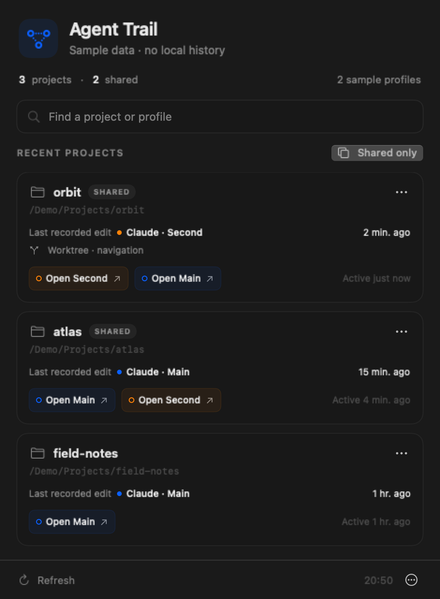

# Agent Trail

**Which agent touched this project last?**

A small native macOS menu-bar app that brings your coding projects into one place. See the latest recorded edit, find projects shared across profiles, and jump back to the right running app.

**Public alpha · macOS 14+ · Claude Desktop profiles · MIT license**

Agent Trail currently supports multiple Claude Desktop profiles. Codex and other assistants are on the roadmap; their activity is not indexed yet.



*Demo mode. All project names and paths shown are synthetic.*

## Why it exists

Two assistant instances. The same project open in both. Different worktrees, conversations, and changes. Returning to work should not begin with guessing which window has the latest context.

Agent Trail shows each project once, with the profile that made the **last recorded edit** and the profile with the **latest saved activity**. A shared project stays connected to its original folder even when work happens in a separate Claude worktree.

- Search by project path or profile name.
- Filter to projects shared across profiles.
- See worktree context alongside recorded edits.
- Focus an identified running Claude instance with one click.
- Keep everything local, with no account or analytics.

## Try it

Build from source with **Swift 6+**, using Xcode or the Command Line Tools, on macOS 14 or later:

```sh
swift test
./scripts/build-app.sh
open "dist/Agent Trail.app"
```

Run these commands from the repository folder. The app opens its panel immediately and keeps a connected-dots icon in the menu bar, with no Dock icon. Click away to hide it; click the icon to return. The first scan indexes local history in the background. Later scans are incremental, every 15 seconds by default.

To install, copy `dist/Agent Trail.app` to your Applications folder. The script also creates an architecture-labeled ZIP and SHA-256 checksum in `dist/`. These alpha builds use an **ad-hoc signature** and are **not Apple-notarized**. A downloaded build may be blocked by Gatekeeper. Building locally is the supported starting point for this alpha; see Apple's [guidance for opening apps safely](https://support.apple.com/en-us/102445).

The profile buttons focus an existing app instance. They do not open a particular project or conversation inside Claude. Agent Trail does not launch, quit, kill, or restart Claude.

## Configure profiles

Open **Profiles…** from the panel's bottom menu to add or adjust profiles. The default configuration recognizes:

| Profile | Claude config directory | Desktop user data |
| --- | --- | --- |
| Claude · Main | `~/.claude` | Claude's default user-data location |
| Claude · Second | `~/.claude-second` | `~/Library/Application Support/Claude-Second` |

Settings are stored at `~/Library/Application Support/AgentTrail/profiles.json`. This example shows the file structure:

```json
{
  "refreshInterval": 15,
  "sources": [
    {
      "id": "claude-primary",
      "name": "Claude · Main",
      "configDirectory": "~/.claude",
      "bundleIdentifier": "com.anthropic.claudefordesktop"
    },
    {
      "id": "claude-second",
      "name": "Claude · Second",
      "configDirectory": "~/.claude-second",
      "userDataDirectory": "~/Library/Application Support/Claude-Second",
      "bundleIdentifier": "com.anthropic.claudefordesktop"
    }
  ]
}
```

Use unique, stable `id` values. Each profile needs its Claude config directory and the matching desktop user-data folder. Only the main `~/.claude` profile may omit the desktop folder to use Claude's default. Set `refreshInterval` between 5 and 300 seconds. A complete [example configuration](docs/profiles.example.json) is included. Choose **Reload profiles** after editing this file by hand. Invalid settings are reported instead of silently scanning another configuration.

Instance matching uses the bundle identity, process arguments, and `CLAUDE_CONFIG_DIR`. An outlined profile dot means a unique running instance could not be identified. When identity is ambiguous or unavailable, Agent Trail reports the problem.

## What the timestamps mean

| Label | Evidence |
| --- | --- |
| **Last recorded edit** | The newest successful `Edit` or `Write` tool result found in Claude's saved logs. |
| **Latest activity** | The newest saved session activity, including work that may not change a file. |
| **Shared** | The same canonical project folder appears in more than one configured profile. |

**This is a record of supported agent activity, not a complete audit of file changes.** Shell commands, external editors, other assistants, and unrecorded changes are not attributed. Failed tools and user-modified results are excluded. A project with no recorded edits may still have changed. File modification times do not establish which assistant made a change.

Claude's on-disk formats are private implementation details and can change without notice. Missing or unreadable data appears as a profile notice. This alpha has not been tested against every Claude version or installation layout.

## Privacy

Indexing happens on your Mac. Agent Trail reads local desktop session indexes and associated JSONL logs, including subagent logs. It does not send those records anywhere, inject code, install hooks, or edit Claude's data. There are no telemetry, cloud accounts, or automatic update checks.

The incremental cache at `~/Library/Application Support/AgentTrail/activity-cache.json` stores file positions, tool IDs, project/workspace paths, and dates. It does not store prompts, commands, patches, or conversation text. Paths can still be sensitive; keep caches and diagnostic output private. With Agent Trail closed, deleting this cache causes a fresh index on the next launch.

External links in the app open in your browser only when selected. See [security and reporting](SECURITY.md) before sharing an issue or diagnostic output.

## Preview with sample projects

```sh
swift run AgentTrail --demo
```

Demo mode uses synthetic projects and does not read Claude histories, your profile configuration, or the activity cache. It is suitable for screenshots and walkthroughs. Quit the demo from its menu when finished.

## Development

There are no third-party package dependencies. The Swift package includes the native app, a reusable core, tests, and a diagnostic CLI.

```sh
# Build for a specific CPU, or create a universal binary.
./scripts/build-app.sh --arch arm64
./scripts/build-app.sh --arch x86_64 --output-dir dist/intel
./scripts/build-app.sh --arch universal2 --output-dir dist/universal

# Preview local metadata without storing a scan cache.
swift run AgentTrailInspect --metadata-only
```

Each build creates `Agent Trail.app`, `Agent-Trail-macOS-<architecture>.zip`, and a matching `.sha256` file in the selected output folder. Architecture-specific ZIPs run on that architecture; `universal2` contains both arm64 and x86_64. Cross-architecture compilation does not validate execution on the other architecture.

`ARCH` can set the build architecture and `AGENTTRAIL_BUILD_DIR` can select a separate Swift build cache. The build script does not install or launch apps. Inspection reads your real local data and can print project paths; review its output before sharing. The CLI uses saved profiles (or defaults if settings are absent). Pass `--profiles /path/to/profiles.json` to inspect a separate configuration.

CI runs tests and packages the app on Apple Silicon and Intel macOS runners. The manually triggered **Release artifacts** workflow produces ZIPs and checksums for review; it does not publish a release or upload code to another repository. Runner labels follow GitHub's [hosted runner documentation](https://docs.github.com/en/actions/how-tos/write-workflows/choose-where-workflows-run/choose-the-runner-for-a-job).

Read [CONTRIBUTING.md](CONTRIBUTING.md) for development guidance. New adapters should translate supported records into `ProjectActivity` through `ActivityProvider`, keeping recorded edits separate from general activity.

## What's next

- A Codex adapter, then additional assistants with reliable local evidence.
- More coverage of changes made through agent shell commands.
- A global hotkey and optional launch at login.
- Signed, notarized downloads and a simpler installation path.

## Support the project

[Bug reports](https://github.com/NotYaz/agent-trail/issues), compatibility reports, and thoughtful contributions help the alpha mature. Optional crypto support is described in [Support](docs/SUPPORT.md). Donation details are published only after the maintainer provides verified wallet addresses and their networks.

Agent Trail is an independent project, not affiliated with Anthropic, OpenAI, or other assistant vendors. Licensed under [MIT](LICENSE).
